# 2010—2026年全国硕士研究生招生考试 · 英语（二）写作真题大全（纯题目版）

> **说明**：本文档包含 2010 年至 2026 年英语二大作文（Part B）与小作文（Part A）共 34 道全部全真试题题目。

## 快速导航

- [第一部分：英语二大作文真题题目 (2010—2026年)](#第一部分英语二大作文真题题目-20102026年)
- [第二部分：英语二小作文真题题目 (2010—2026年)](#第二部分英语二小作文真题题目-20102026年)

---

# 第一部分：英语二大作文真题题目 (2010—2026年)

## 【大作文】2010年 动态折线图 · 2000-2008年发展中与发达国家移动电话订户数变化

- **考试年份**：2010年
- **图表类型**：动态折线图 (Line Chart)
- **考查主题**：2000-2008年发展中与发达国家移动电话订户数变化

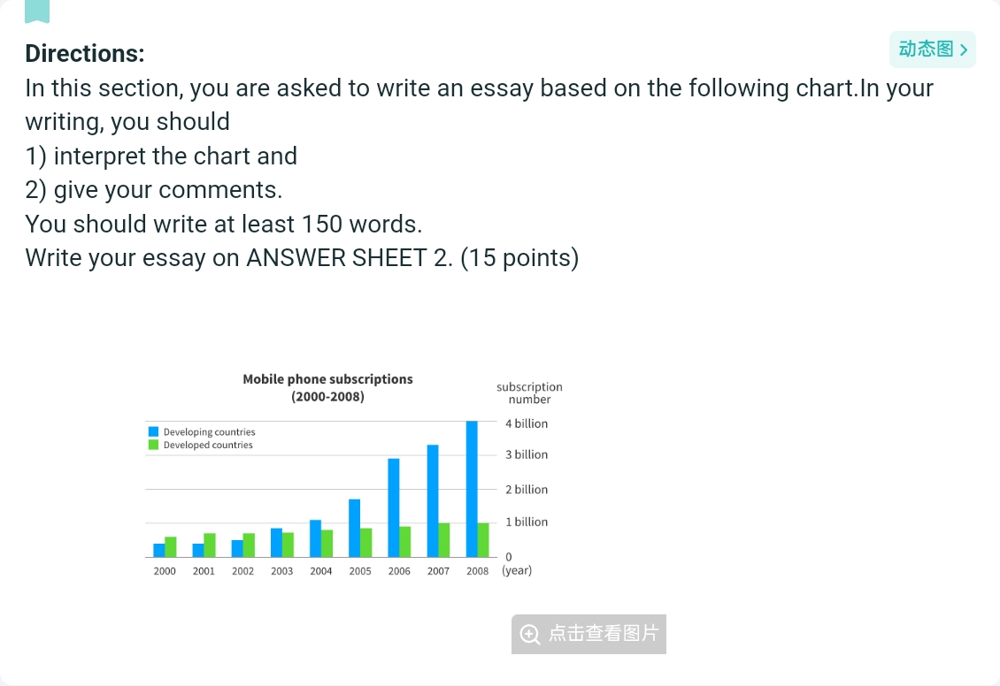

```text
In this section, you are asked to write an essay based on the following chart. In your writing, you should:
1) interpret the chart, and
2) give your comments.
You should write at least 150 words on ANSWER SHEET 2. (15 points)
```

---

## 【大作文】2011年 静态对比柱状图 · 2008与2009年我国国内轿车市场份额对比

- **考试年份**：2011年
- **图表类型**：静态对比柱状图 (Bar Chart)
- **考查主题**：2008与2009年我国国内轿车市场份额对比

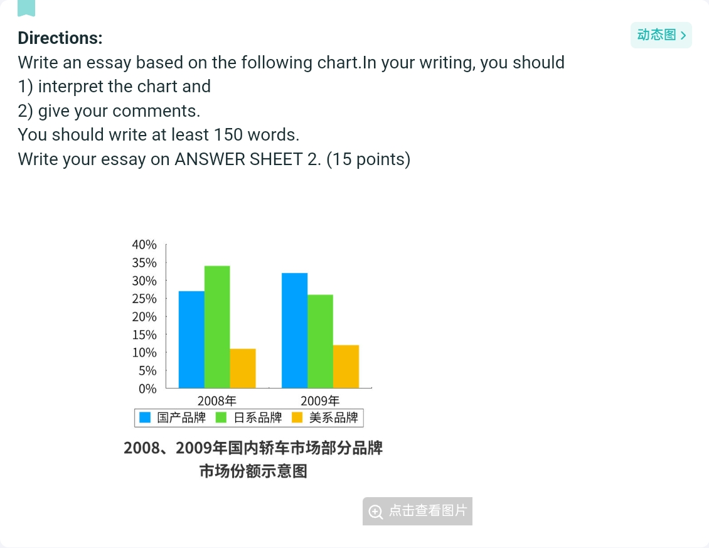

```text
Write an essay based on the following chart. In your writing, you should:
1) interpret the chart, and
2) give your comments.
You should write at least 150 words on ANSWER SHEET 2. (15 points)
```

---

## 【大作文】2012年 数据表格 · 某公司不同年龄段员工工作满意度调查

- **考试年份**：2012年
- **图表类型**：数据表格 (Table)
- **考查主题**：某公司不同年龄段员工工作满意度调查

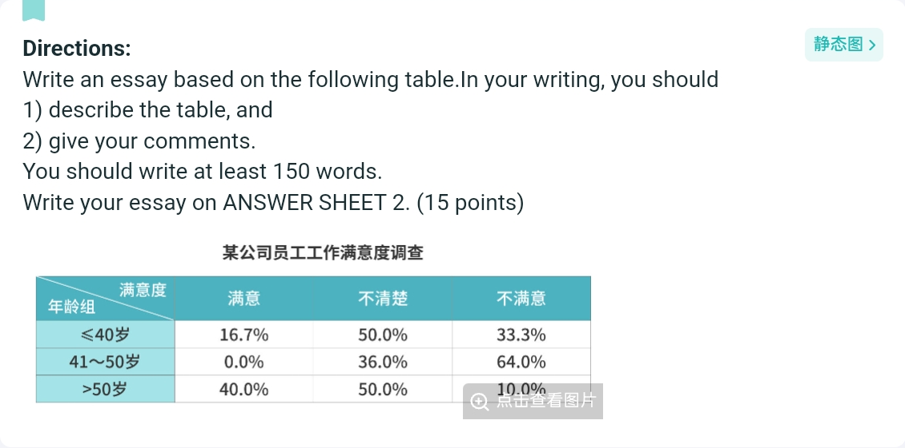

```text
Write an essay based on the following table. In your writing, you should:
1) describe the table, and
2) give your comments.
You should write at least 150 words on ANSWER SHEET 2. (15 points)
```

---

## 【大作文】2013年 递增柱状图 · 某高校大学生兼职情况按年级分布调查

- **考试年份**：2013年
- **图表类型**：递增柱状图 (Bar Chart)
- **考查主题**：某高校大学生兼职情况按年级分布调查

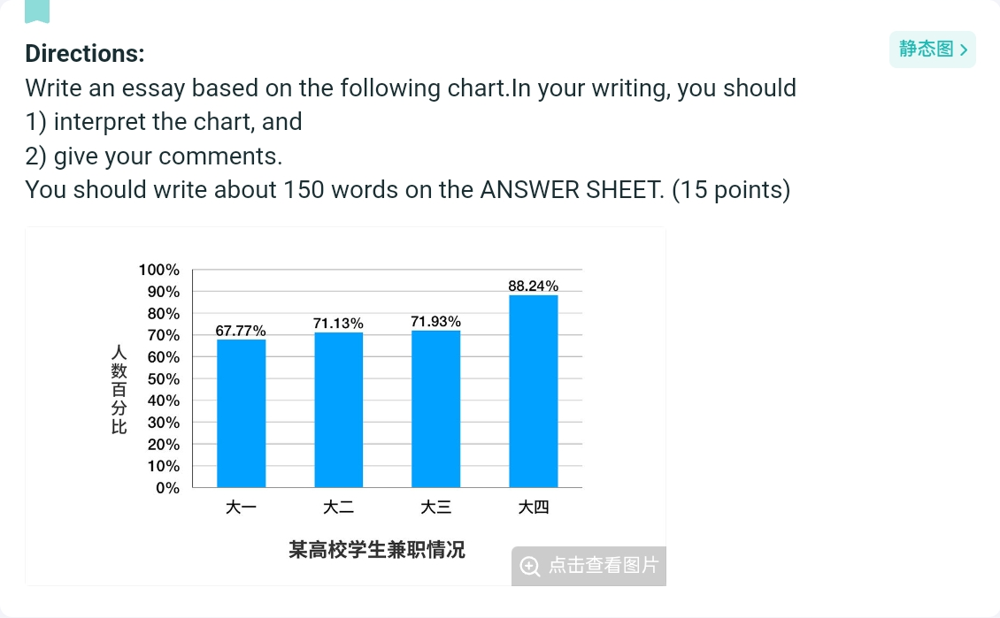

```text
Write an essay based on the following chart. In your writing, you should:
1) interpret the chart, and
2) give your comments.
You should write about 150 words on the ANSWER SHEET. (15 points)
```

---

## 【大作文】2014年 双主体对比柱状图 · 1990-2010年中国城镇人口与乡村人口数量及比例变化

- **考试年份**：2014年
- **图表类型**：双主体对比柱状图 (Bar Chart)
- **考查主题**：1990-2010年中国城镇人口与乡村人口数量及比例变化

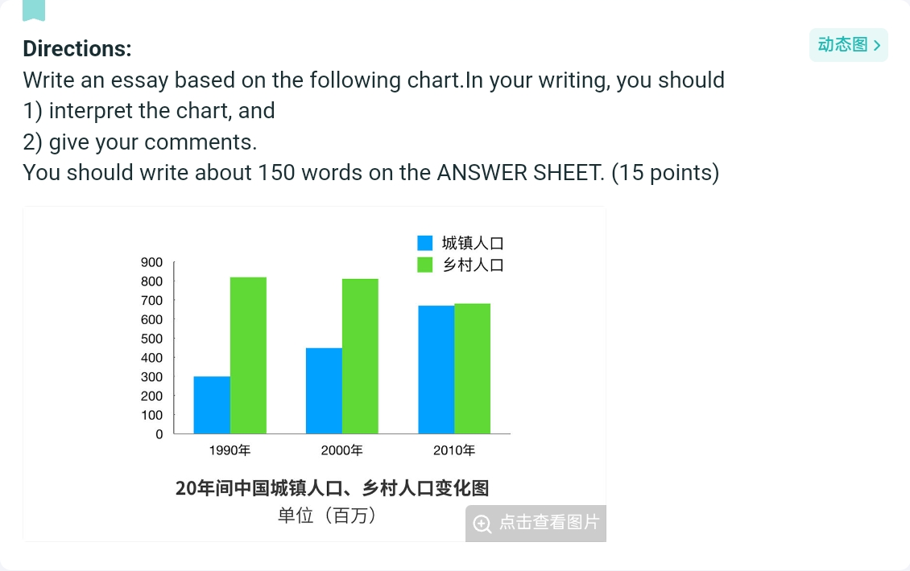

```text
Write an essay based on the following chart. In your writing, you should:
1) interpret the chart, and
2) give your comments.
You should write about 150 words on the ANSWER SHEET. (15 points)
```

---

## 【大作文】2015年 静态占比饼状图 · 某市居民春节假期消费支出构成比例

- **考试年份**：2015年
- **图表类型**：静态占比饼状图 (Pie Chart)
- **考查主题**：某市居民春节假期消费支出构成比例

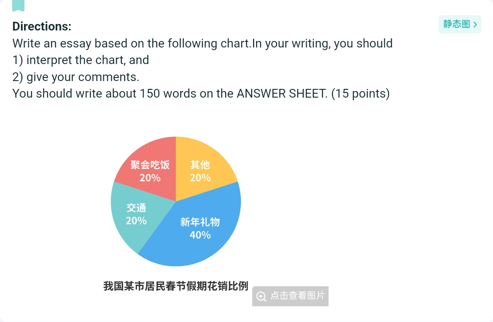

```text
Write an essay based on the following chart. In your writing, you should:
1) interpret the chart, and
2) give your comments.
You should write about 150 words on the ANSWER SHEET. (15 points)
```

---

## 【大作文】2016年 静态占比饼状图 · 某高校大学生旅游目的调查

- **考试年份**：2016年
- **图表类型**：静态占比饼状图 (Pie Chart)
- **考查主题**：某高校大学生旅游目的调查

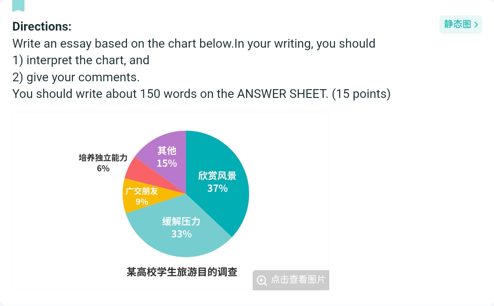

```text
Write an essay based on the chart below. In your writing, you should:
1) interpret the chart, and
2) give your comments.
You should write about 150 words on the ANSWER SHEET. (15 points)
```

---

## 【大作文】2017年 双轴综合图 · 2013-2015年我国博物馆数量与参观人次增长

- **考试年份**：2017年
- **图表类型**：双轴综合图 (Line & Bar Chart)
- **考查主题**：2013-2015年我国博物馆数量与参观人次增长

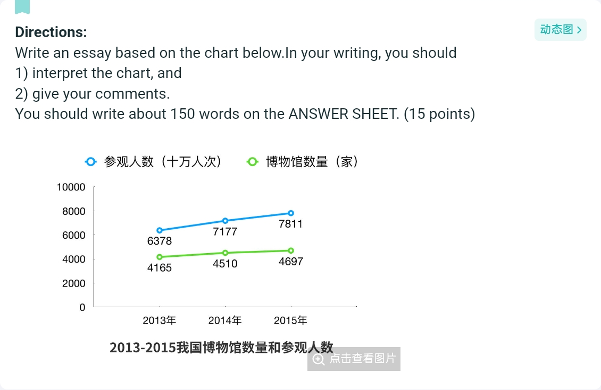

```text
Write an essay based on the chart below. In your writing, you should:
1) interpret the chart, and
2) give your comments.
You should write about 150 words on the ANSWER SHEET. (15 points)
```

---

## 【大作文】2018年 静态占比饼状图 · 2017年某市消费者选择餐厅时的主要关注因素

- **考试年份**：2018年
- **图表类型**：静态占比饼状图 (Pie Chart)
- **考查主题**：2017年某市消费者选择餐厅时的主要关注因素

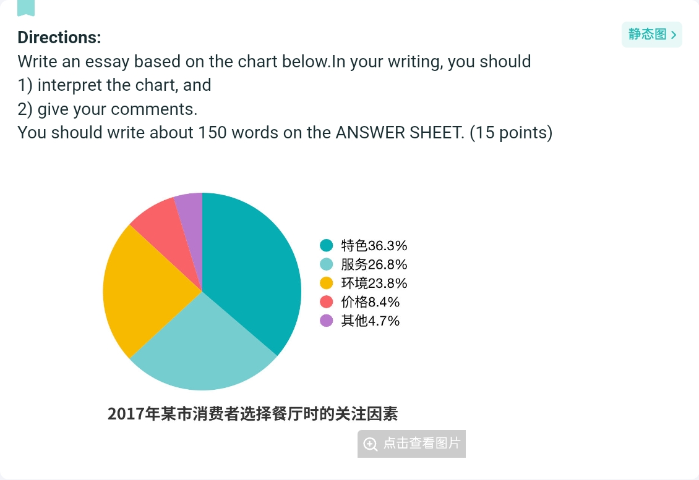

```text
Write an essay based on the chart below. In your writing, you should:
1) interpret the chart, and
2) give your comments.
You should write about 150 words on the ANSWER SHEET. (15 points)
```

---

## 【大作文】2019年 多主体动态对比柱状图 · 某高校2013年与2018年本科毕业生去向对比

- **考试年份**：2019年
- **图表类型**：多主体动态对比柱状图 (Bar Chart)
- **考查主题**：某高校2013年与2018年本科毕业生去向对比

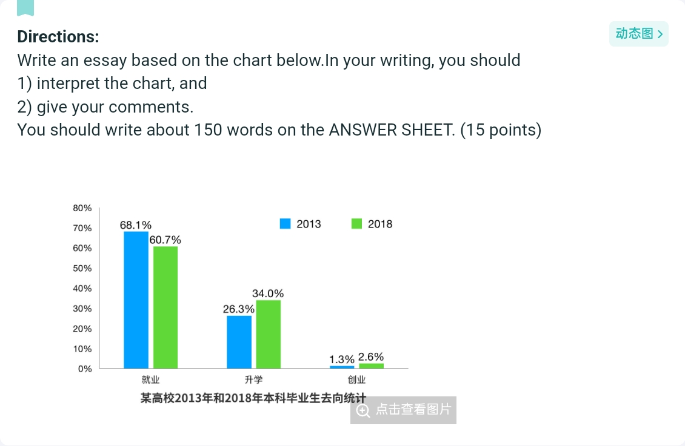

```text
Write an essay based on the chart below. In your writing, you should:
1) interpret the chart, and
2) give your comments.
You should write about 150 words on the ANSWER SHEET. (15 points)
```

---

## 【大作文】2020年 静态占比饼状图 · 某高校大学生手机阅读目的调查

- **考试年份**：2020年
- **图表类型**：静态占比饼状图 (Pie Chart)
- **考查主题**：某高校大学生手机阅读目的调查

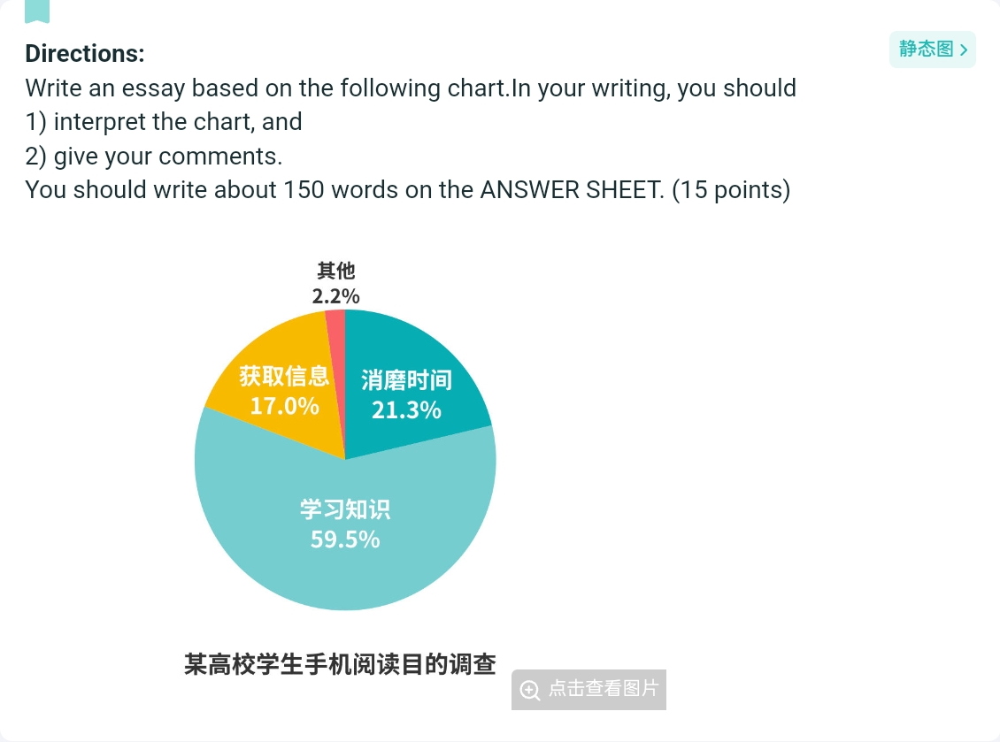

```text
Write an essay based on the following chart. In your writing, you should:
1) interpret the chart, and
2) give your comments.
You should write about 150 words on the ANSWER SHEET. (15 points)
```

---

## 【大作文】2021年 静态多选对比柱状图 · 某市居民体育锻炼方式偏好调查

- **考试年份**：2021年
- **图表类型**：静态多选对比柱状图 (Bar Chart)
- **考查主题**：某市居民体育锻炼方式偏好调查

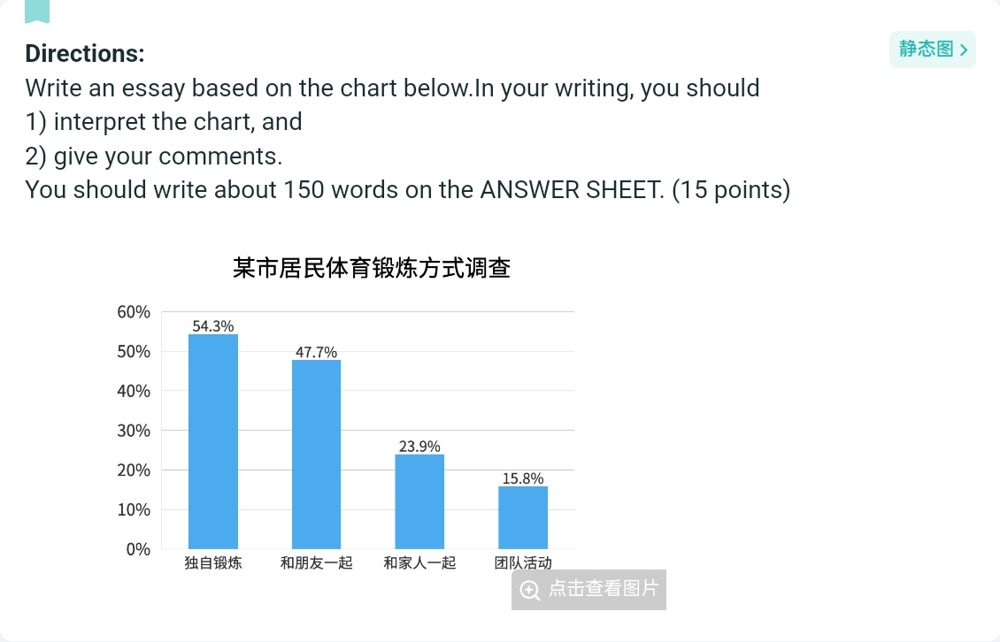

```text
Write an essay based on the chart below. In your writing, you should:
1) interpret the chart, and
2) give your comments.
You should write about 150 words on the ANSWER SHEET. (15 points)
```

---

## 【大作文】2022年 动态递增柱状图 · 2018-2020年我国快递业务量增长变化

- **考试年份**：2022年
- **图表类型**：动态递增柱状图 (Bar Chart)
- **考查主题**：2018-2020年我国快递业务量增长变化

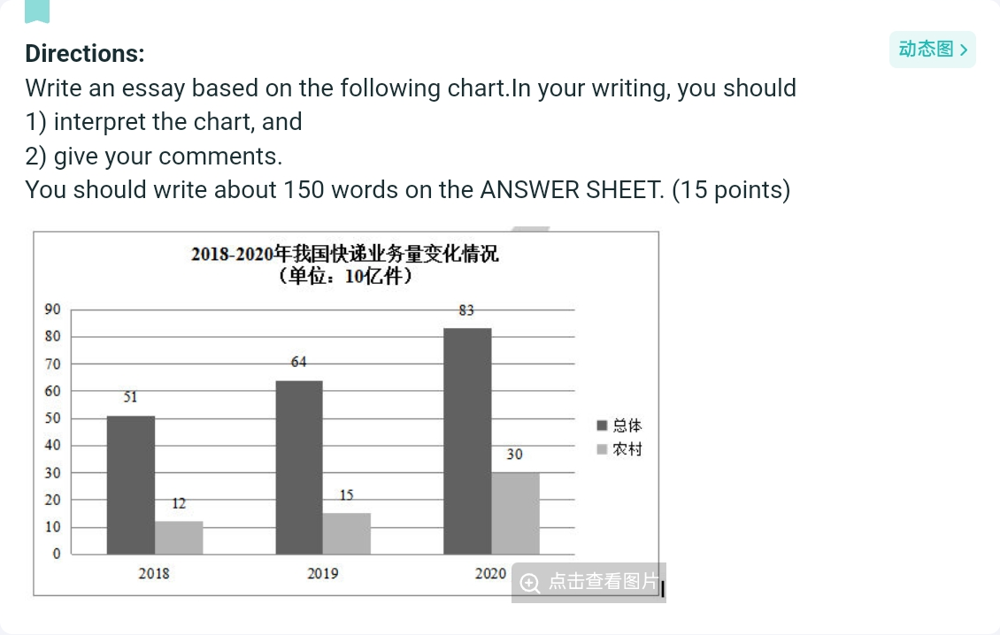

```text
Write an essay based on the following chart. In your writing, you should:
1) interpret the chart, and
2) give your comments.
You should write about 150 words on the ANSWER SHEET. (15 points)
```

---

## 【大作文】2023年 长期动态折线图 · 2012-2021年某市高校学生体质健康测试达标率变化

- **考试年份**：2023年
- **图表类型**：长期动态折线图 (Line Chart)
- **考查主题**：2012-2021年某市高校学生体质健康测试达标率变化

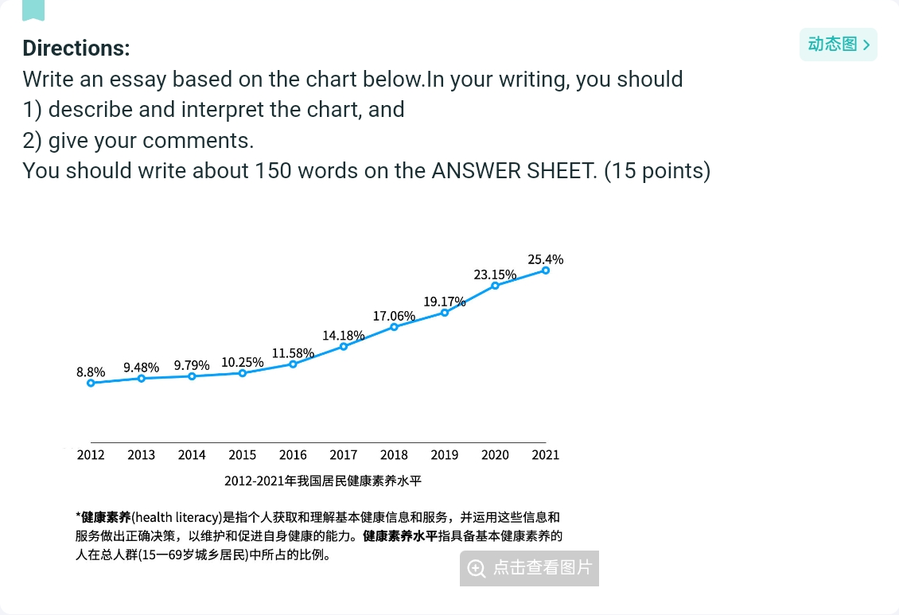

```text
Write an essay based on the chart below. In your writing, you should:
1) describe and interpret the chart, and
2) give your comments.
You should write about 150 words on the ANSWER SHEET. (15 points)
```

---

## 【大作文】2024年 静态多选对比柱状图 · 某市居民阅读目的偏好调查

- **考试年份**：2024年
- **图表类型**：静态多选对比柱状图 (Bar Chart)
- **考查主题**：某市居民阅读目的偏好调查

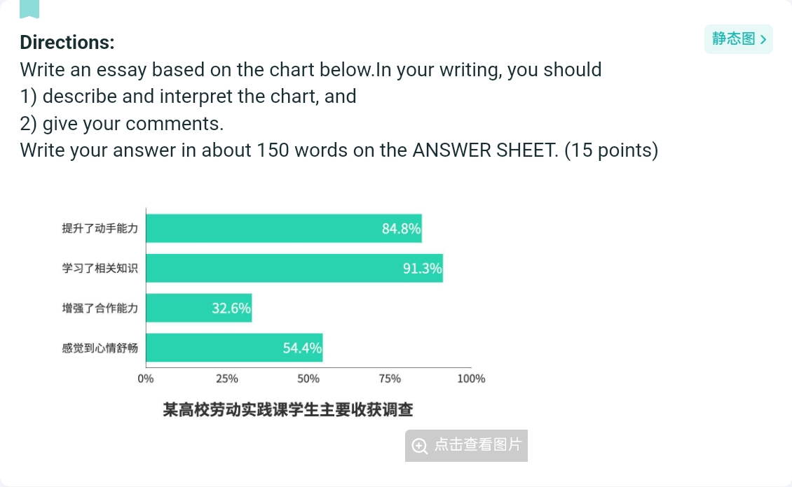

```text
Write an essay based on the chart below. In your writing, you should:
1) describe and interpret the chart, and
2) give your comments.
Write your answer in about 150 words on the ANSWER SHEET. (15 points)
```

---

## 【大作文】2025年 多项对比柱状图 · 某市居民日常闲暇活动偏好调查

- **考试年份**：2025年
- **图表类型**：多项对比柱状图 (Bar Chart)
- **考查主题**：某市居民日常闲暇活动偏好调查

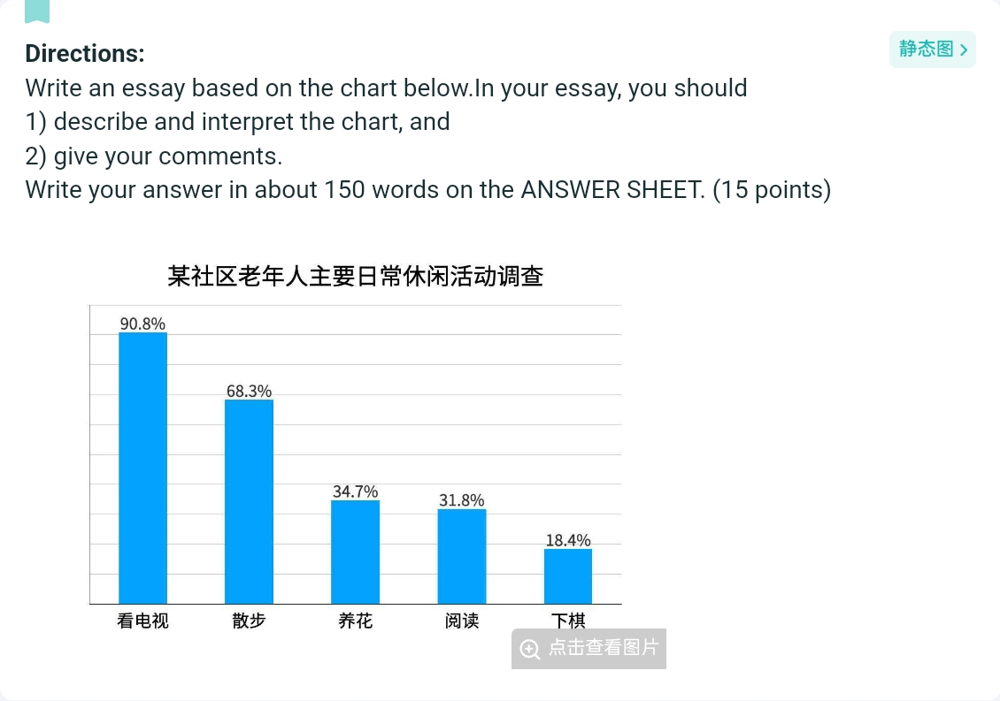

```text
Write an essay based on the chart below. In your essay, you should:
1) describe and interpret the chart, and
2) give your comments.
Write your answer in about 150 words on the ANSWER SHEET. (15 points)
```

---

## 【大作文】2026年 多项对比柱状图 · 某市儿童课外活动偏好与素质发展调查

- **考试年份**：2026年
- **图表类型**：多项对比柱状图 (Bar Chart)
- **考查主题**：某市儿童课外活动偏好与素质发展调查

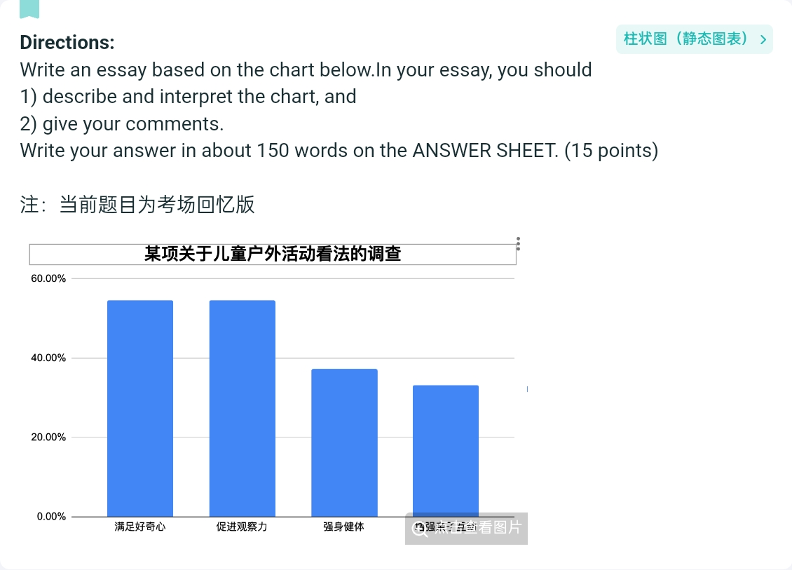

```text
Write an essay based on the chart below. In your essay, you should:
1) describe and interpret the chart, and
2) give your comments.
Write your answer in about 150 words on the ANSWER SHEET. (15 points)
```

---

# 第二部分：英语二小作文真题题目 (2010—2026年)

## 【小作文】2010年 感谢信 · 回国后向美国同事致谢并邀请访华

- **考试年份**：2010年
- **文体类型**：书信 · 感谢信 (Letter of Thanks)
- **考查主题**：回国后向美国同事致谢并邀请访华

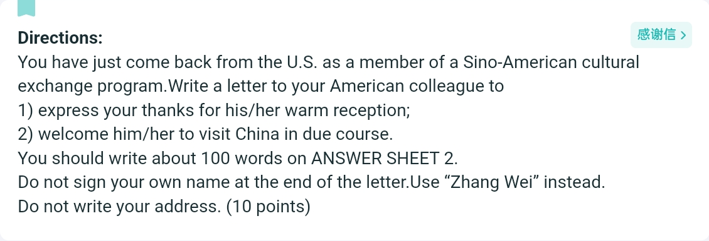

```text
Suppose you have just returned from an exchange program. Write a letter to your American colleague to
1) express your thanks for his/her warm reception;
2) welcome him/her to visit China in due course.
You should write about 100 words on ANSWER SHEET 2.
Do not sign your own name at the end of the letter. Use "Zhang Wei" instead.
Do not write your address. (10 points)
```

---

## 【小作文】2011年 祝贺信与建议信 · 祝贺堂弟考上大学并提供大学生活建议

- **考试年份**：2011年
- **文体类型**：书信 · 祝贺信与建议信 (Congratulations & Advice)
- **考查主题**：祝贺堂弟考上大学并提供大学生活建议

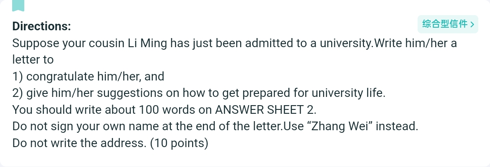

```text
Suppose your cousin Li Ming has just been admitted to a university. Write him/her a letter to
1) congratulate him/her, and
2) give him/her suggestions on how to get prepared for university life.
You should write about 100 words on ANSWER SHEET 2.
Do not sign your own name at the end of the letter. Use "Zhang Wei" instead. (10 points)
```

---

## 【小作文】2012年 投诉信 · 网购电子词典质量故障投诉并要求解决方案

- **考试年份**：2012年
- **文体类型**：书信 · 投诉信 (Letter of Complaint)
- **考查主题**：网购电子词典质量故障投诉并要求解决方案

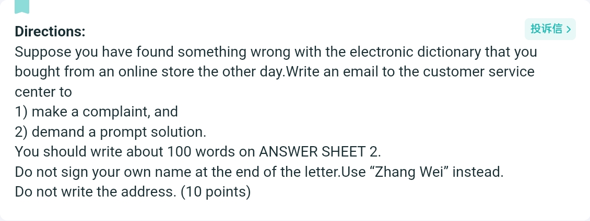

```text
Suppose you have found something wrong with the electronic dictionary that you bought from an online store the other day. Write an email to the customer service center to
1) make a complaint, and
2) demand a prompt solution.
You should write about 100 words on ANSWER SHEET 2.
Do not sign your own name at the end of the letter. Use "Zhang Wei" instead. (10 points)
```

---

## 【小作文】2013年 倡议信/通知 · 组织为困境儿童爱心义卖活动倡议与通知

- **考试年份**：2013年
- **文体类型**：书信 · 倡议信/通知 (Email of Notice)
- **考查主题**：组织为困境儿童爱心义卖活动倡议与通知

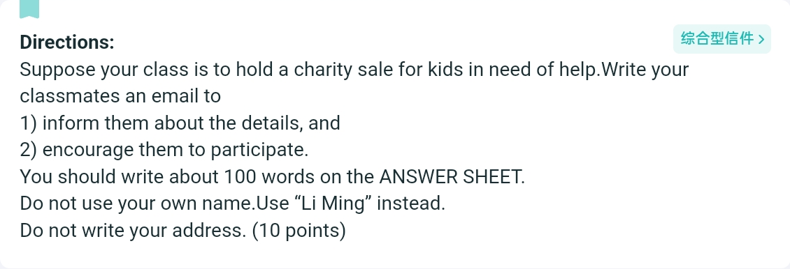

```text
Suppose your class is to hold a charity sale for kids in need of help. Write your classmates an email to
1) inform them about the details, and
2) encourage them to participate.
You should write about 100 words on the ANSWER SHEET.
Do not use your own name. Use "Li Ming" instead. (10 points)
```

---

## 【小作文】2014年 介绍与询问信 · 留学合租向外国室友介绍生活习惯并寻求建议

- **考试年份**：2014年
- **文体类型**：书信 · 介绍与询问信 (Email of Inquiry)
- **考查主题**：留学合租向外国室友介绍生活习惯并寻求建议

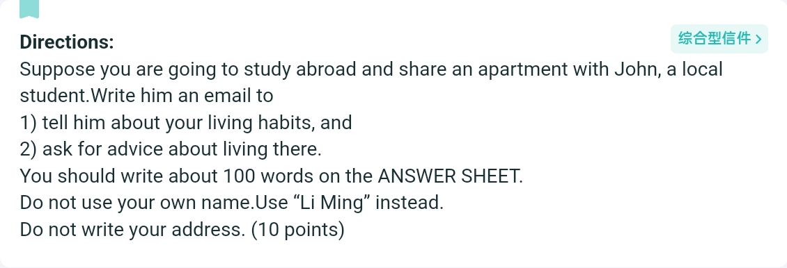

```text
Suppose you are going to study abroad and share an apartment with John, a local student. Write him an email to
1) tell him about your living habits, and
2) ask for advice about living there.
You should write about 100 words on the ANSWER SHEET.
Do not use your own name. Use "Li Ming" instead. (10 points)
```

---

## 【小作文】2015年 通知招募 · 大学主办中学生夏令营及招募志愿者通知

- **考试年份**：2015年
- **文体类型**：告示 · 通知招募 (Notice for Volunteers)
- **考查主题**：大学主办中学生夏令营及招募志愿者通知

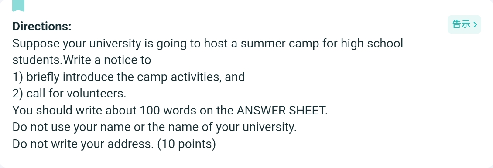

```text
Suppose your university is going to host a summer camp for high school students. Write a notice to
1) briefly introduce the camp activities, and
2) call for volunteers.
You should write about 100 words on the ANSWER SHEET.
Do not use your name or the name of your university. (10 points)
```

---

## 【小作文】2016年 感谢信与建议信 · 回信致谢好友祝贺并提供翻译学习建议

- **考试年份**：2016年
- **文体类型**：书信 · 感谢信与建议信 (Thanks & Advice)
- **考查主题**：回信致谢好友祝贺并提供翻译学习建议

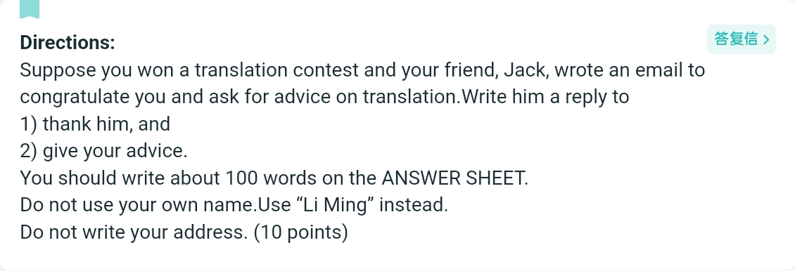

```text
Suppose you won a translation contest and your friend, Jack, wrote an email to congratulate you and ask for advice on translation. Write him a reply to
1) thank him, and
2) give your advice.
You should write about 100 words on the ANSWER SHEET.
Do not use your own name. Use "Li Ming" instead. (10 points)
```

---

## 【小作文】2017年 接受邀请信 · 接受教授邀请为留学生作中国文化讲座及要点介绍

- **考试年份**：2017年
- **文体类型**：书信 · 接受邀请信 (Acceptance of Invitation)
- **考查主题**：接受教授邀请为留学生作中国文化讲座及要点介绍

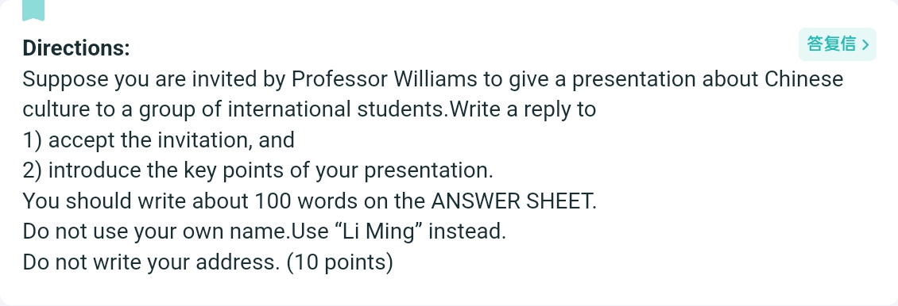

```text
Suppose you are invited by Professor Williams to give a presentation about Chinese culture to a group of international students. Write a reply to
1) accept the invitation, and
2) introduce the key points of your presentation.
You should write about 100 words on the ANSWER SHEET.
Do not use your own name. Use "Li Ming" instead. (10 points)
```

---

## 【小作文】2018年 道歉信 · 因故取消行程致歉教授并提议改期会面

- **考试年份**：2018年
- **文体类型**：书信 · 道歉信 (Letter of Apology)
- **考查主题**：因故取消行程致歉教授并提议改期会面

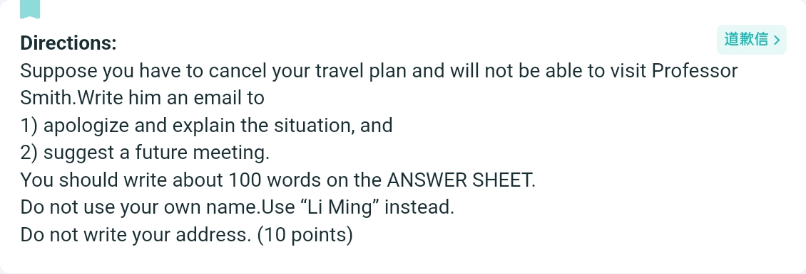

```text
Suppose you have to cancel your travel plan and will not be able to visit Professor Smith. Write him an email to
1) apologize and explain the situation, and
2) suggest a future meeting.
You should write about 100 words on the ANSWER SHEET.
Do not use your own name. Use "Li Ming" instead. (10 points)
```

---

## 【小作文】2019年 建议信与方案陈述 · 协助教授策划城市交通辩论赛建议及安排

- **考试年份**：2019年
- **文体类型**：书信 · 建议信与方案陈述 (Email of Suggestions)
- **考查主题**：协助教授策划城市交通辩论赛建议及安排

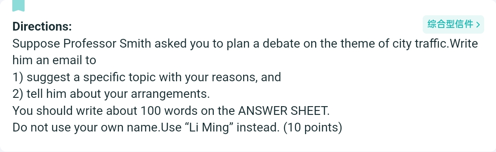

```text
Suppose Professor Smith asked you to plan a debate on the theme of city traffic. Write him an email to
1) suggest a specific topic with your reasons, and
2) tell him about your arrangements.
You should write about 100 words on the ANSWER SHEET.
Do not use your own name. Use "Li Ming" instead. (10 points)
```

---

## 【小作文】2020年 告知与建议信 · 为留学生规划历史文化名胜游览与出行贴士

- **考试年份**：2020年
- **文体类型**：书信 · 告知与建议信 (Email of Information & Tips)
- **考查主题**：为留学生规划历史文化名胜游览与出行贴士

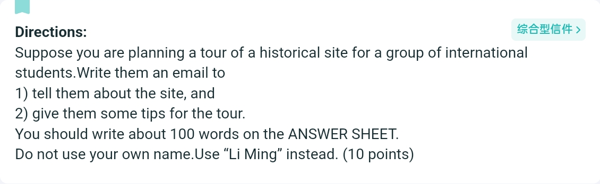

```text
Suppose you are planning a tour of a historical site for a group of international students. Write them an email to
1) tell them about the site, and
2) give them some tips for the tour.
You should write about 100 words on the ANSWER SHEET.
Do not use your own name. Use "Li Ming" instead. (10 points)
```

---

## 【小作文】2021年 邀请信与会议通知 · 邀请留学生Jack参加线上研讨会并告知细节

- **考试年份**：2021年
- **文体类型**：书信 · 邀请信与会议通知 (Email of Invitation)
- **考查主题**：邀请留学生Jack参加线上研讨会并告知细节

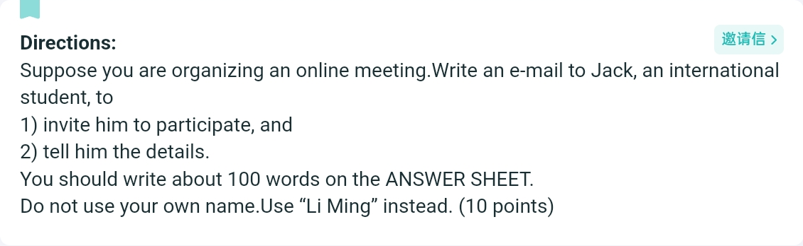

```text
Suppose you are organizing an online meeting. Write an e-mail to Jack, an international student, to
1) invite him to participate, and
2) tell him the details.
You should write about 100 words on the ANSWER SHEET.
Do not use your own name. Use "Li Ming" instead. (10 points)
```

---

## 【小作文】2022年 邀请信与活动推介 · 向留学生推介校园国际美食节并邀请参与

- **考试年份**：2022年
- **文体类型**：书信 · 邀请信与活动推介 (Email of Invitation)
- **考查主题**：向留学生推介校园国际美食节并邀请参与

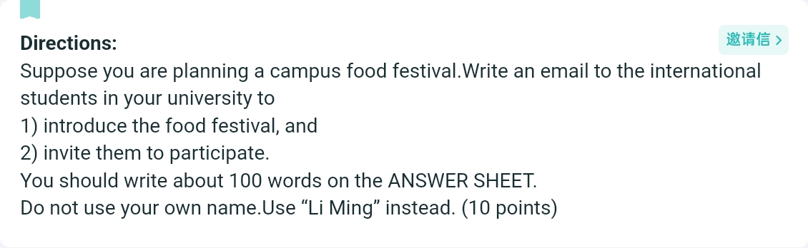

```text
Suppose you are planning a campus food festival. Write an email to the international students to
1) introduce the festival, and
2) invite them to participate.
You should write about 100 words on the ANSWER SHEET.
Do not use your own name. Use "Li Ming" instead. (10 points)
```

---

## 【小作文】2023年 建议信/推荐信 · 在艺术展与机器人展之间为留学生提供建议推荐

- **考试年份**：2023年
- **文体类型**：书信 · 建议信/推荐信 (Email of Recommendation)
- **考查主题**：在艺术展与机器人展之间为留学生提供建议推荐

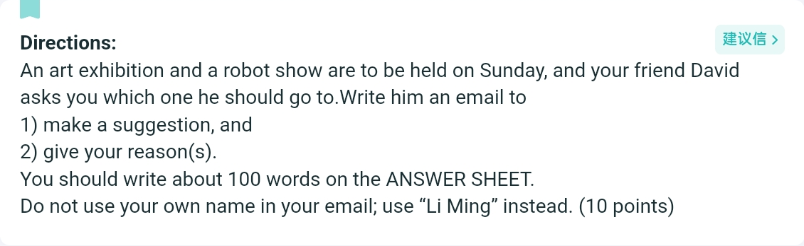

```text
An art exhibition and a robot show are to be held on Sunday. An international student, Jack, asks you which one he should go to. Write him an email to
1) introduce the events, and
2) give your recommendation with reasons.
You should write about 100 words on the ANSWER SHEET.
Do not use your own name. Use "Li Ming" instead. (10 points)
```

---

## 【小作文】2024年 建议信与调研构想 · 与好友合作大学生阅读习惯问卷设计及设问理由

- **考试年份**：2024年
- **文体类型**：书信 · 建议信与调研构想 (Email of Suggestions)
- **考查主题**：与好友合作大学生阅读习惯问卷设计及设问理由

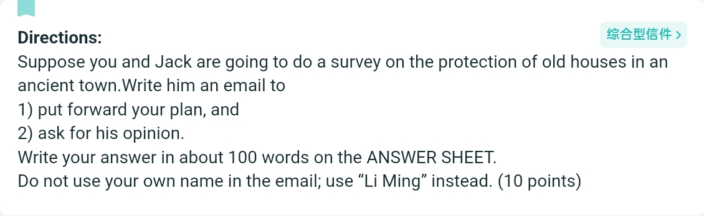

```text
Suppose you and Jack are going to do a survey on students' reading habits. Write an email to Jack to
1) propose two questions, and
2) explain the reasons.
You should write about 100 words on the ANSWER SHEET.
Do not use your own name. Use "Li Ming" instead. (10 points)
```

---

## 【小作文】2025年 邀请信与方案介绍 · 邀请好友排练中国经典故事短剧并介绍构想

- **考试年份**：2025年
- **文体类型**：书信 · 邀请信与方案介绍 (Email of Invitation)
- **考查主题**：邀请好友排练中国经典故事短剧并介绍构想

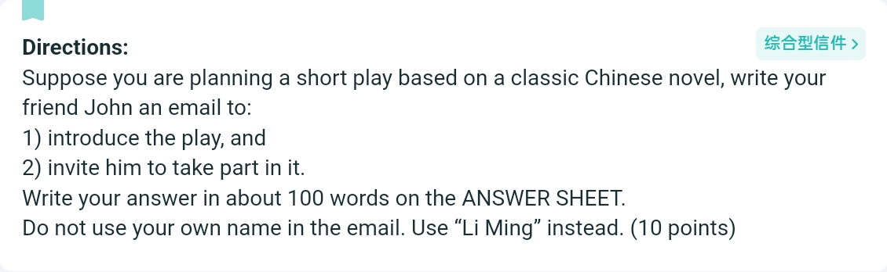

```text
Suppose you are planning a short play based on a Chinese classical story. Write an email to Jack to
1) invite him to participate, and
2) give a brief introduction to the play.
You should write about 100 words on the ANSWER SHEET.
Do not use your own name. Use "Li Ming" instead. (10 points)
```

---

## 【小作文】2026年 反馈与建议信 · 观看中国家庭旅行视频反馈并提出了解愿望与建议

- **考试年份**：2026年
- **文体类型**：书信 · 反馈与建议信 (Email of Feedback & Suggestions)
- **考查主题**：观看中国家庭旅行视频反馈并提出了解愿望与建议

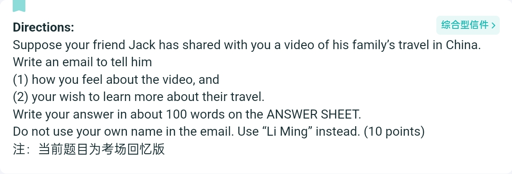

```text
Suppose your friend Jack has shared with you a video of his family's travel in China. Write an email to tell him
(1) how you feel about the video, and
(2) your wish to learn more about their travel.
Write your answer in about 100 words on the ANSWER SHEET.
Do not use your own name in the email. Use "Li Ming" instead. (10 points)
```

---
